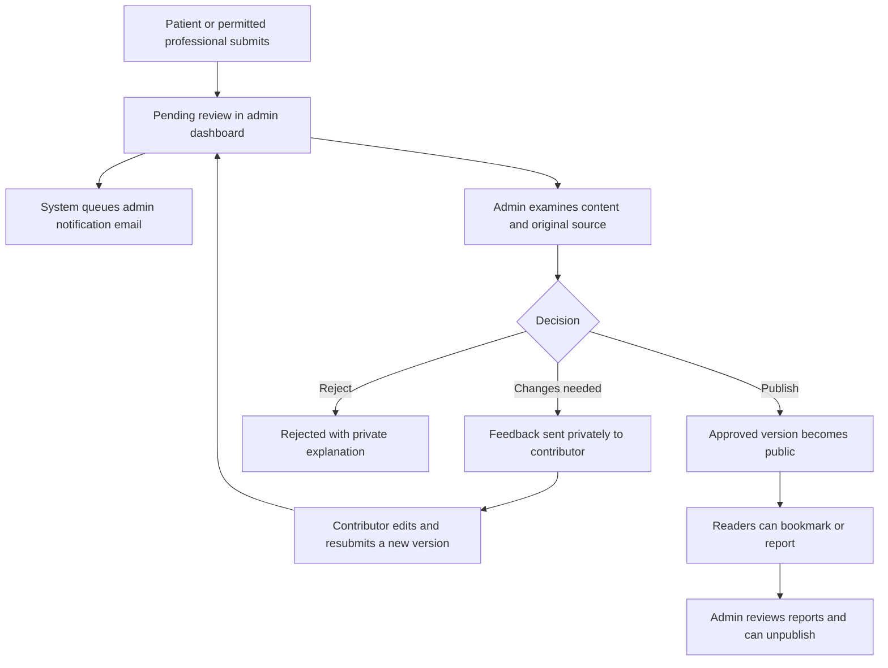

# MindBridge — Learn & Unwind content portal

**Implementation handoff for the team**  
**Status:** Agreed feature specification; this document does not mean the portal is implemented.  
**Scope:** Curated mental-health resources, professional contributions and patient submissions.

## 1. What we are building

Build a portal named **Learn & Unwind**, matching the existing mint-and-white MindBridge UI. Patients can browse useful resources and calming posts. Administrators control publication. Approved professionals with contributor permission and registered patients can submit content for review.

The portal is separate from Telegram peer discussion and the chatbot. It provides information and personal reflections, not diagnosis, treatment or emergency support.

### Initial content types

| Type | Content |
|---|---|
| Podcast | Link to an external episode and a short introduction |
| Expert talk / video | External video link, speaker and source details |
| Research explained | Link to the original paper and an understandable summary |
| Gentle read | An original wellbeing or reflection post |
| Relaxation guide | A short activity or link to an existing MindBridge activity |
| Personal reflection | A patient's experience, clearly distinguished from professional guidance |

Reuse existing relaxation activities through links; do not create a second activity system.

## 2. Permissions

| User | Allowed actions |
|---|---|
| Visitor | Read published public content only |
| Patient | Browse, bookmark, submit a suggestion/reflection, see own submission outcomes, report content |
| Approved professional with contributor permission | Patient-level content actions plus professional resource/article submission |
| Approved professional without contributor permission | Browse and report; no professional publishing privileges |
| Admin | Create drafts, review submissions, request changes, reject, publish, archive, unpublish and manage contributor permission |

- Professional approval **does not automatically grant content permission**.
- Admin has a separate **Can contribute content** setting for approved professionals.
- For the first release, **all submissions require admin publication**, including professional submissions.
- Admin-created clinical material must still pass the applicable content review; admin status is not a clinical qualification.
- Recommended initial access rule: require approved patient registration for submissions. Keep the rule consistent in the UI and API.
- Check current account role, registration status and contributor permission on the server. Do not trust frontend flags or stale role claims.
- Patients and professionals can view only their own non-public submissions. Admin can view the review queue.

## 3. Patient-facing experience

### Browse page

Use cards with title, thumbnail, content type, short description, language and approximate reading/listening duration. Include:

- Filters: topic, language and content format.
- Search by title and description.
- Bookmark / saved resources.
- A clear **Suggest a resource or share a reflection** button.
- A **My submissions** page with status and reviewer feedback.

### Resource detail page

Show title, summary/body, content type, topic, author/speaker, source, original publication date where known and last review date. Include optional content notes, bookmark and report actions.

For external media, prefer **Watch on YouTube**, **Listen to podcast**, or **Read original source**. Use external links for the first release. No autoplay, automatic third-party embeds or external tracking scripts.

Personal reflections must carry: **Personal experience — not medical advice.**

Do not display “Clinically reviewed” unless an appropriately qualified reviewer has actually reviewed that version and the review is recorded.

## 4. Submission form

Use a modal or dedicated page with the same form styles as existing registration screens.

| Field | Rule |
|---|---|
| Submission type | Required; choose from supported types |
| Title | Required; suggested maximum 150 characters |
| External link | Required for video, podcast and external research/article resources; HTTPS only |
| Why this is useful / short summary | Required; suggested maximum 600 characters |
| Post body | Required for original posts/reflections; suggested maximum 5,000 characters |
| Topic | Required; choose from controlled categories |
| Language | Required |
| Author/speaker and source | Required where known for external/professional resources; allow “unknown” for a suggestion so admin can investigate |
| Approximate duration | Optional; minutes |
| Public attribution | For patients: display chosen name or “Community contributor” |
| Sensitive-content note | Optional suggestion from contributor; admin finalises it |
| Sharing declaration | Required: permission to share, no identifiable information about other people, understanding that review is required |

Use helper text: **Your submission will be reviewed before publication. This form is not monitored as an emergency service.**

Do not request diagnoses, medical reports or chatbot transcripts. Avoid collecting new personal information for submission.

**No patient file uploads in the first release.** Accept links and text. Administrators can choose an approved thumbnail or use a standard category illustration.

“Community contributor” is anonymous only to public readers. Authorised admins retain the account identity for review and abuse handling.

## 5. Review workflow

### Statuses

- `draft`: contributor/admin is preparing content.
- `pending_review`: submitted and waiting for a decision.
- `needs_changes`: admin requests specific changes.
- `rejected`: declined with private feedback.
- `published`: approved revision visible in the portal.
- `archived`: no longer publicly listed.
- `withdrawn`: contributor withdraws an unpublished submission.

### Version rules

- Each submission/re-submission creates a reviewable version.
- Require an expected version for review decisions to prevent approving stale content.
- An author cannot directly change a published revision.
- Edits create a new pending revision; the previously approved revision remains public until replacement is approved, unless admin unpublishes it.
- If admin makes a material change to a patient's personal story, request the contributor's approval before publication. Do not silently change its meaning.
- Keep reviewer, decision, feedback, revision and timestamp in a review history.
- Only the selected approved revision is returned by public APIs. Never expose drafts through predictable IDs.

## 6. Admin dashboard

Add **Content portal** with these views:

1. **Review queue** — pending submissions, oldest first; filters for type and contributor category.
2. **Published content** — edit through revisions, feature/unfeature, archive or unpublish.
3. **Create content** — prepare an admin draft.
4. **Reports** — review concerns and broken links.
5. **Contributor permissions** — grant/revoke professional contribution access.

### Review detail screen

Show:

- Submission reference, account identity (admin-only), professional type where relevant and public attribution choice.
- Type, title, summary, body, topic, language and proposed source details.
- Safely rendered preview and clearly displayed destination domain.
- Open-source link; review history and revision number.
- Private feedback field and optional internal note.
- Clinical-review record where needed: reviewer, qualification/scope, review date and reviewed revision.
- Actions: **Publish**, **Request changes**, **Reject** and **Archive/unpublish** where applicable.

Email alerts direct admins here. Receiving an email or successfully checking a URL does not constitute approval.

## 7. Moderation requirements

Before publication, the reviewer checks:

- Relevance and respectful, non-stigmatising language.
- No identifiable information about other patients or private conversations.
- No harmful instructions, harassment, promotional spam or misleading treatment claims.
- Source credibility, authorship and permission to share.
- Clear separation of research, clinical guidance and personal experience.
- Appropriate sensitive-content notes where needed.
- Whether clinical claims require a qualified professional's review.

A thumbnail, metadata fetch, automated classifier or AI summary is not sufficient to approve a video. A reviewer must examine the relevant original content. Automation may flag issues, but must not automatically publish submissions.

Link to original research rather than copying complete articles or videos. Do not imply that a single paper proves a treatment works.

Reports should support reasons such as misleading information, privacy concern, harmful material, copyright concern and broken link. Allow a short optional explanation, with a warning not to include medical details. Admin can unpublish immediately while investigating. A report should not automatically remove content without a defined moderation policy.

Assign a review date and periodic link/content checks. For the first release, manual review is acceptable; display actual review dates only.

## 8. Email automation

Use a durable database queue and worker, following the project's existing email approach. Do not send SMTP inside submission/review HTTP requests.

Create notification jobs in the same transaction as the submission or decision. Use an idempotency key such as `(submission_id, revision, event, audience)` to prevent duplicate queue entries. Reuse configured SMTP and application URL settings; do not add credentials to source code.

### Admin: new submission

**Subject:** New portal submission awaiting review — {{reference}}

> A new {{contentType}} submission is awaiting review.
>
> Reference: {{reference}}  
> Contributor category: {{patientOrProfessional}}  
> Submitted: {{timestamp}}
>
> Review securely: {{adminReviewUrl}}
>
> Please review the original content before making a publication decision.

Do not include the personal story, clinical details or submitted external URL in this notification. The authenticated dashboard contains the submission.

### Contributor: receipt

**Subject:** We received your content suggestion — {{reference}}

> Your submission has been received and is awaiting review. It is not publicly visible yet.
>
> View its status: {{mySubmissionUrl}}

### Contributor: changes requested

**Subject:** Changes requested for your submission — {{reference}}

> Please sign in to read the review feedback, update your submission and resubmit it.
>
> View feedback: {{mySubmissionUrl}}

### Contributor: published

**Subject:** Your contribution has been published — {{reference}}

> Your contribution has been approved and published with your selected public attribution.
>
> View the published resource: {{publicContentUrl}}

### Contributor: rejected

**Subject:** An update on your content submission — {{reference}}

> Your submission was reviewed and was not approved for publication. Sign in to read the explanation.
>
> View outcome: {{mySubmissionUrl}}

### Admin: content reported

**Subject:** Published content needs review — {{reference}}

> A reader has reported a concern. Please sign in to review the report and content.
>
> Review report: {{adminReportUrl}}

Keep rejection feedback, report text and personal stories out of emails. Escape all HTML and build dashboard links from the trusted application origin. Emails must not contain one-click publication actions that bypass authentication.

Worker requirements: retry/backoff, maximum attempts, lease recovery, safe failure codes, delivery status and admin retry. SMTP acceptance is not proof of inbox delivery. Document that delivery is at least once; crashes can result in duplicate notifications.

## 9. Suggested database structure

These are proposed tables, not an instruction to overwrite existing community tables. Inspect existing migrations before choosing final names; add a new migration after the latest migration in the repository.

| Table | Main fields / purpose |
|---|---|
| `portal_submissions` | `id`, `author_user_id`, `status`, `current_revision`, `published_revision_id`, `created_at`, `updated_at`; workflow identity |
| `portal_revisions` | `id`, `submission_id`, `revision_number`, `type`, `title`, `summary`, `body`, `external_url`, `source_name`, `speaker_author`, `language`, `topic`, `duration_minutes`, `public_attribution`, `content_note`, `sharing_declaration_version`, `sharing_declared_at`, `created_at`; immutable submitted versions |
| `portal_review_events` | `id`, `submission_id`, `revision_id`, `reviewer_user_id`, `decision`, `private_feedback`, `internal_note`, `created_at`; recorded decisions |
| `portal_clinical_reviews` | `id`, `revision_id`, `reviewer_user_id`, `qualification_scope_snapshot`, `outcome`, `reviewed_at`; evidence for any clinical-review label |
| `portal_contributors` | `user_id`, `enabled`, `granted_by`, `granted_at`, `revoked_at`; permission separate from professional registration |
| `portal_bookmarks` | `user_id`, `submission_id`, `created_at`; private saved resources |
| `portal_reports` | `id`, `submission_id`, `revision_id`, `reporter_user_id`, `reason`, `details`, `status`, `reviewed_by`, `resolved_at`, `created_at`; moderation queue |
| `portal_email_jobs` | `id`, `submission_id`, `revision`, `event`, `audience`, `status`, `attempts`, `available_at`, `lease_token`, `locked_at`, `sent_at`, `last_error`; transactional notification queue |

### Constraints and indexes

- Foreign keys for all related accounts, submissions and revisions.
- Check constraints for allowed content types, statuses, decisions and report reasons.
- Unique `(submission_id, revision_number)` and `(user_id, submission_id)` for bookmarks.
- Ensure the published revision belongs to its submission, ideally through a composite foreign key.
- Unique notification event key; use a report ID in the key for report notifications so separate reports do not collide.
- Index review queue `(status, created_at)`, author submissions `(author_user_id, created_at)`, report queue `(status, created_at)` and email jobs `(status, available_at)`.
- Index public filters according to measured query needs; do not add an index for every column.
- Use transactions for review decisions and notification enqueueing.
- Private feedback and personal submissions may be sensitive: use the project's encryption conventions where appropriate, minimise logs, and define access/retention procedures. Do not publish encrypted storage objects directly.
- Deletion/anonymisation and retention policy must be agreed before a real launch. Do not invent a statutory retention period.

## 10. Suggested API boundaries

Exact route names can follow existing project conventions.

| Method / endpoint | Access and purpose |
|---|---|
| `GET /api/portal/resources` | Public; published revisions only, filters and pagination |
| `GET /api/portal/resources/:id` | Public; selected published revision only |
| `POST /api/portal/submissions` | Eligible authenticated contributor; create draft/submission |
| `GET /api/portal/my-submissions` | Own submissions only |
| `GET /api/portal/my-submissions/:id` | Own revisions and shareable reviewer feedback; exclude internal admin notes |
| `PUT /api/portal/my-submissions/:id` | Owner; create/update eligible draft with version check |
| `POST /api/portal/my-submissions/:id/submit` | Owner; submit/resubmit after validation |
| `POST /api/portal/my-submissions/:id/withdraw` | Owner; withdraw unpublished submission |
| `PUT /api/portal/bookmarks/:id` | Authenticated user; idempotently save |
| `DELETE /api/portal/bookmarks/:id` | Authenticated user; remove own bookmark |
| `GET /api/portal/bookmarks` | Own bookmarks; omit unavailable content |
| `POST /api/portal/resources/:id/reports` | Authenticated reader; rate-limited report |
| `GET /api/admin/portal/submissions` | Admin; review queue |
| `GET /api/admin/portal/submissions/:id` | Admin; full review context |
| `POST /api/admin/portal/submissions/:id/decision` | Admin; versioned decision and email jobs |
| `POST /api/admin/portal/resources/:id/unpublish` | Admin; reason required, audited |
| `PUT /api/admin/portal/contributors/:userId` | Admin; grant/revoke permission after checking professional approval |
| `GET /api/admin/portal/reports` | Admin; report queue |
| `PATCH /api/admin/portal/reports/:id` | Admin; record outcome |

Define consistent pagination limits, validation errors and 401/403/404/409 responses. Do not expose whether another user's private submission exists through detailed errors.

## 11. Link, content and privacy security

- Validate on the server as well as the client. Allow HTTPS URLs only; reject credentials embedded in URLs and non-web schemes such as `javascript:`.
- First release: store links without server-side fetching. This avoids turning submissions into server-side request forgery requests.
- If metadata fetching is added later, block private/internal addresses and unsafe redirects, handle DNS rebinding, set response-size/time limits and allow only expected content types. A basic URL regex is not sufficient.
- Open external links with `rel="noopener noreferrer"`; show the destination domain. Consider a no-referrer policy for outbound links from sensitive pages.
- Render text as escaped text or sanitised Markdown. Never render submitted raw HTML or arbitrary iframe code.
- Use rate limits and submission-size limits; prevent repeated report/email spam.
- No medical details in logs, email subjects, URL parameters or analytics events.
- Do not personalise resources using private chatbot transcripts, diagnoses or screening results in this version.
- Keep moderation and bookmarks private. Do not expose reporter identities or internal reviewer notes to authors or public readers.
- Keep clinical credentials separate from public profile fields. Revoking contributor permission must take effect on subsequent API calls.
- Link changes create a reviewable revision. External content can change after approval; provide reporting and re-review rather than claiming permanent safety.

## 12. Implementation order

1. Inspect project conventions, current migrations, role checks and email worker. Do not read or commit environment secrets.
2. Add additive database migration and models with constraints and ownership checks.
3. Implement submission and versioned review APIs, then admin review UI.
4. Build published-resource list/detail pages and submission form.
5. Add contributor permissions, bookmarks and reports.
6. Integrate durable email jobs and delivery monitoring.
7. Test with synthetic posts and team-controlled inboxes. Do not publish sample medical claims as real guidance.

## 13. Acceptance checklist

- [ ] A patient can submit a link or reflection, but cannot publish it.
- [ ] A professional needs both approval and separate contributor permission.
- [ ] Revoked permissions and stale login roles cannot bypass server checks.
- [ ] A submission appears in the admin dashboard even when SMTP is unavailable.
- [ ] Submission and decision transactions reliably enqueue the intended emails once.
- [ ] Only published revisions appear in public searches, detail routes and bookmarks.
- [ ] Other users cannot retrieve private submissions or internal notes by changing IDs.
- [ ] Request-changes, resubmission, rejection and publication workflows work.
- [ ] Concurrent/stale review attempts return a conflict rather than overwriting decisions.
- [ ] Published edits remain hidden until reviewed; material personal-story edits require author agreement.
- [ ] Clinical-review labels have evidence for the exact published revision.
- [ ] Text/HTML injection and unsafe URL schemes are rejected or safely rendered.
- [ ] Reports reach the admin queue and admins can unpublish promptly.
- [ ] Public anonymous attribution does not expose account email, internal user identifiers or report identities.
- [ ] Email content contains no personal stories, sensitive feedback or credential documents.
- [ ] Bookmark uniqueness, notification retries and failed-delivery handling are tested.
- [ ] Mobile layouts, empty/loading/error states, keyboard navigation and form labels work.
- [ ] Existing registration, booking, chatbot and community features still work.

## 14. Out of scope for the initial release

Public comments, direct messages, patient file uploads, live streaming, automatic AI publication, personalised clinical recommendations, embedded payment services and a second Telegram-style discussion feed.

**Deliverable expected from implementer:** working portal, admin review tools, migrations, email templates/worker integration, tests and a short setup/demo guide. Commit code and documentation only; never credentials or real patient submissions.
