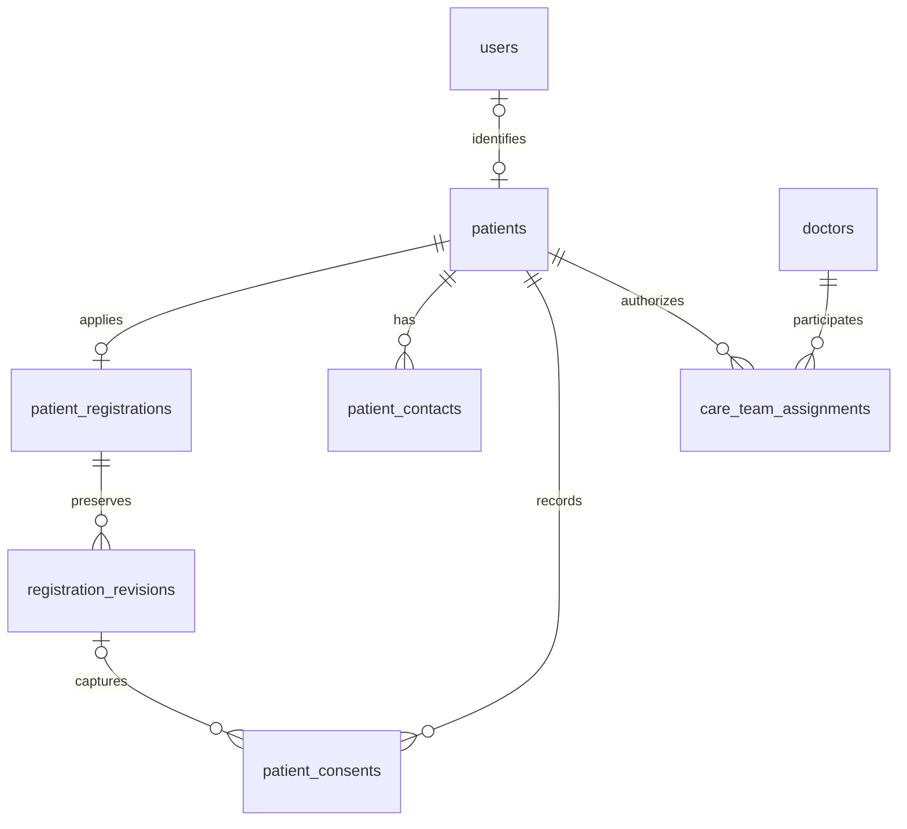

# Patient registry database foundation

This change adds the patient-registry foundation to the existing PostgreSQL application. It is additive: existing user IDs, registration endpoints, appointment relationships, and the registration form remain compatible.

## New tables

| Table | Identity and relationships | Purpose |
| --- | --- | --- |
| `patients` | UUID PK, nullable unique `user_id`, generated unique `patient_number` | Patient identity independent of the account; encrypted approved demographics and clinical context; pending/active/archived status |
| `registration_revisions` | UUID PK; composite FK to registration owner/patient; unique owner + application version | Immutable encrypted snapshots at each submission |
| `patient_contacts` | UUID PK; patient FK; unique patient + origin | Encrypted trusted-contact details; separate purpose, verification, and archival metadata |
| `patient_consents` | UUID PK; patient/actor/revision FKs; monotonic event sequence | Append-only purpose-specific consent and acknowledgement history |
| `care_team_assignments` | UUID PK; patient and existing doctor-profile FKs | Explicit provider access scope, expiry, grant/revocation attribution and encrypted reasons |
| `schema_migrations` | Migration ID PK, SHA-256 checksum | Tracks application of schema versions and adoption of existing legacy tables |

`patient_registrations.patient_id` connects the existing application to a patient. The composite foreign key ensures its user ID and patient ID refer to the same account. Existing registration events remain the workflow-decision history; revisions preserve the data submitted, rather than only the decisions.



## Lifecycle and privacy

1. Submission creates/links a pending patient and records the encrypted application revision, contact, choices, and workflow event in one transaction.
2. Requesting information or declining requires the existing optimistic application version. Resubmission retains the original revision and creates another; workflow versions can have gaps between submission revisions.
3. Approval copies selected demographics and optional clinical context into separate encrypted patient fields. Pending application data is never presented as approved patient demographics.
4. The administrator's registry endpoint excludes clinical context and contacts. Doctors receive only assigned active patients; the `demographics` scope never exposes clinical context. `clinical_context` adds the optional registration care information, not a diagnosis or full medical-record permission.
5. A trusted contact is not a guardian by default and is not a proxy login. Recording a contact authorizes neither notifications nor medical-record access. Contact verification starts unset.
6. Patients can withdraw/re-enable appointment reminder permission through a dedicated endpoint. New decisions append to history; consumers must read the latest event per purpose, ordered by `event_sequence`. The immutable application snapshot is not the current reminder preference.
7. Care-team grants require an active patient, an approved doctor account with a doctor profile, and an attributed reason. Revocation and expiry remove registry access; the provider's current database role is rechecked. Expired assignments must be explicitly revoked before reassigning the same provider, preserving their history.
8. New registry list/read/grant/revoke/preference operations write audit metadata without medical details. Access middleware rechecks the actor's current account role rather than trusting an old JWT role.

Demographics and clinical context remain encrypted JSON payloads. Dates of birth inside ciphertext cannot be queried as native SQL dates; do not add plaintext copies just for search. Operational IDs, status, timestamps, relationships, and pagination are typed/indexed columns. Patient numbers are formatted as `MB-000001` in API responses.

## Migration and compatibility

From the repository root, with your normal deployment configuration available:

```powershell
npm --prefix server run migrate:postgres
```

The runner takes a PostgreSQL transaction advisory lock, applies all pending changes in one transaction, and records checksums. Existing complete base/registration table groups are adopted instead of replaying the old `DROP COLUMN` and grandfathering statements. Incomplete table groups are rejected for reconciliation; adoption is not a full schema-drift validator. Future changes belong in new migration files and new entries in `migrationRunner.js`, never edits to applied migrations.

Migration 003 backfills patients for existing patient accounts and registration owners, retains the current application as a `migration_snapshot`, reconstructs approved demographics from available data, and records only explicit choices that exist in the source. Earlier overwritten applications cannot be reconstructed. Legacy empty approval snapshots stay empty; available legacy profile fields populate the patient record without inventing consent. No prior care-team access is inferred from bookings.

Back up the database and encryption keys before deployment. Migration requires the existing encryption key to decrypt legacy fields; failures roll back the schema, backfill, and ledger together. This implementation was tested with synthetic data in embedded PostgreSQL, not applied to the configured application database. No `.env` files were opened during implementation.

Clinical record retention is protected using restrictive foreign keys and append-only history triggers. Account hard-deletion may now fail for registered patients; implement an institution-approved deactivation/retention workflow rather than deleting dependent records. Application database roles should not own tables or have privileges to disable triggers or truncate history tables.

The new registry holds approved application demographics. Existing `profiles` remains a compatibility store for the old profile-settings module; edits there are not automatically synchronized into the registry. A later patient-profile editing workflow should update the registry explicitly with version checks. The present change adds no new frontend management screen.

## API

All endpoints require authentication and return `Cache-Control: no-store`.

| Method / endpoint | Access | Result |
| --- | --- | --- |
| `GET /api/registry/me` | Patient, own record | Approved demographics, care context, active contacts, latest choices, active care team |
| `GET /api/registry/me/registration-history` | Patient, own record | Retained submitted snapshots; migration snapshots are labelled |
| `PUT /api/registry/me/reminder-consent` | Patient | Body `{ "enabled": false }` appends withdrawal; true appends grant |
| `GET /api/registry/patients?limit=25&offset=0` | Admin or doctor | Admin registry or doctor's assigned active patients; `hasMore` for pagination |
| `GET /api/registry/patients/:patientId` | Admin or assigned doctor | Scope-filtered registry record; admin also receives assignment history/IDs for revocation |
| `POST /api/registry/patients/:patientId/care-team` | Admin | Grant an attributed, optionally expiring assignment |
| `PATCH /api/registry/patients/:patientId/care-team/:assignmentId/revoke` | Admin | Body `{ "reason": "Care relationship has ended." }` |

Example assignment body (use a real existing provider user ID):

```json
{
  "providerUserId": "provider-user-id",
  "accessScope": "demographics",
  "reason": "Assigned for the requested consultation.",
  "endsAt": "2027-01-01T00:00:00Z"
}
```

`endsAt` is optional; it must be in the future when present. Patient and assignment path IDs are UUIDs. Existing account/provider IDs remain text.

## Verification

```powershell
npm --prefix server install
npm --prefix server run test:registry
```

The isolated tests use a random test encryption key and an in-memory PGlite database, never the deployment database or environment files. PGlite provides PostgreSQL's `gen_random_uuid`; the adapter omits only the unavailable pgcrypto extension installation. Tests cover fresh/adopted migrations, checksum drift, rollback, encrypted storage, resubmission history, stale decisions, foreign keys, immutable records, scope restrictions, revoked/expired/demoted-provider access, and consent withdrawal. PGlite does not replace a deployment PostgreSQL concurrency/load test.

## Later modules

Encounters, signed clinical notes/amendments, private document uploads, provider/counsellor unification, appointment overlap constraints, email jobs, the missing doctor-application migration, and the knowledge-vector schema repair remain separate work. This foundation does not retroactively change every legacy API's authorization rules or implement automated notifications.
