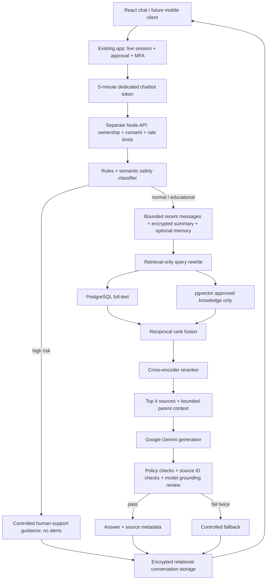
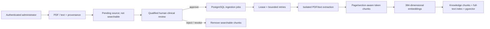

# Service boundaries and flow

## Database tables

All tables are in the isolated `chatbot` schema. External user IDs reference the main identity system logically; there is no duplicated password or user table.

| Table | Purpose and important fields |
|---|---|
| conversations | Owner, creation/update/expiry times; delete cascades to private dependent rows |
| messages | Role and authenticated-encrypted payload (content, sources, route); conversation foreign key |
| conversation_summaries | One encrypted rolling summary per conversation and last message reference |
| user_memories | Owner, encrypted user-chosen memory, explicit consent, independent expiry |
| documents | Immutable uploaded bytes and provenance; approval/ingestion states; reviewer and timestamp |
| document_chunks | Document FK, ordinal, section/page, child and parent text, 384-vector, generated full-text index |
| ingestion_jobs | Unique document job, status, attempts, lease timestamp, retry time, non-content error |
| safety_events | Categories, risk level, classifier version, action; no raw user text |
| retrieval_logs | Retrieved chunk IDs and scores; deliberately omits raw query text |
| feedback | Owned assistant-message rating, fixed reason categories, one rating per user/message |
| knowledge_audit | Reviewer identity and approval/rejection action |

Constraints cover valid statuses/roles, unique chunk ordinals, foreign keys, feedback ratings and approval metadata. Indexes support owner/history queries, expiry cleanup, queue polling, lexical retrieval, and cosine-vector search. Conversation row locks prevent overlapping turns across service replicas. Knowledge jobs check their lease and current approval before publishing chunks, so revoked/re-reviewed sources cannot be published by an old worker.

## Trust boundaries

Treat user input, memories, summaries, extracted text and model output as untrusted. Only server-validated identity establishes ownership; only human approval makes source material retrievable. Source-provided instructions never become system instructions. Generated URLs are rejected; displayed links come from validated HTTPS metadata. React renders content as text, without raw HTML or model-supplied executable markup.

Production retrieval uses PostgreSQL full-text ranking rather than claiming BM25 semantics. The knowledge index contains no private conversation embeddings. The model-based output check is a defence layer, not a clinical assurance claim.

## Gemini provider update
Ollama is no longer used or included in Compose. Configure `GEMINI_API_KEY` and optionally `GEMINI_MODEL` on the **standalone chatbot server process**, not in Vite/frontend variables. Environment files are not automatically loaded by this service. Embedding and reranking services and pgvector remain required; existing 384-dimensional embeddings do not need rebuilding.

Free-tier testing must use synthetic, non-sensitive information only. Google unpaid-service terms prohibit submitting sensitive, confidential or personal information and allow product-improvement processing. Real patient deployment needs an appropriate reviewed provider agreement and data-processing setup. See https://ai.google.dev/gemini-api/terms and https://ai.google.dev/gemini-api/docs/pricing. A key alone does not guarantee free quota.

The RAG pipeline uses multiple Gemini requests per turn (classification, query rewrite, answer, output review and sometimes summary/retry). Quota failures use the existing controlled fallback; no provider error body or key is logged, and no automatic retry storm is added. Default Gemini safety settings remain enabled. Live provider verification requires your key and has not been performed.
